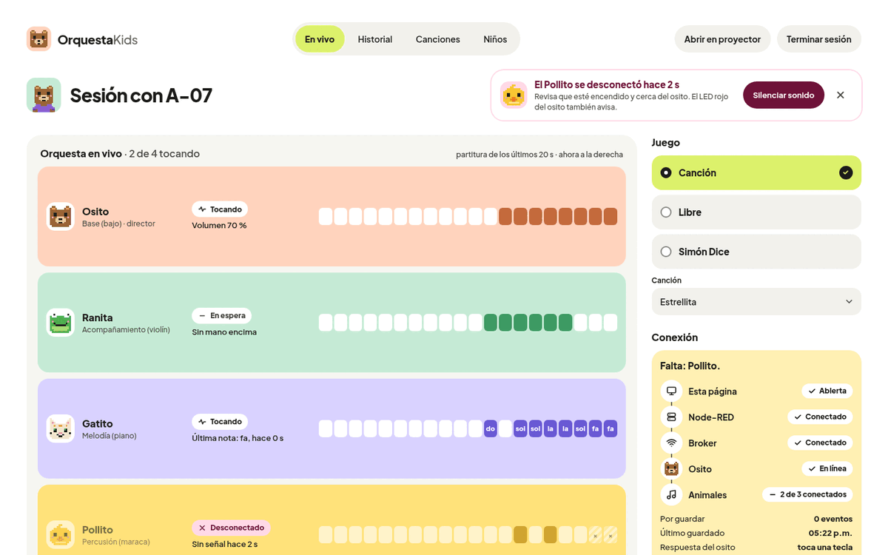
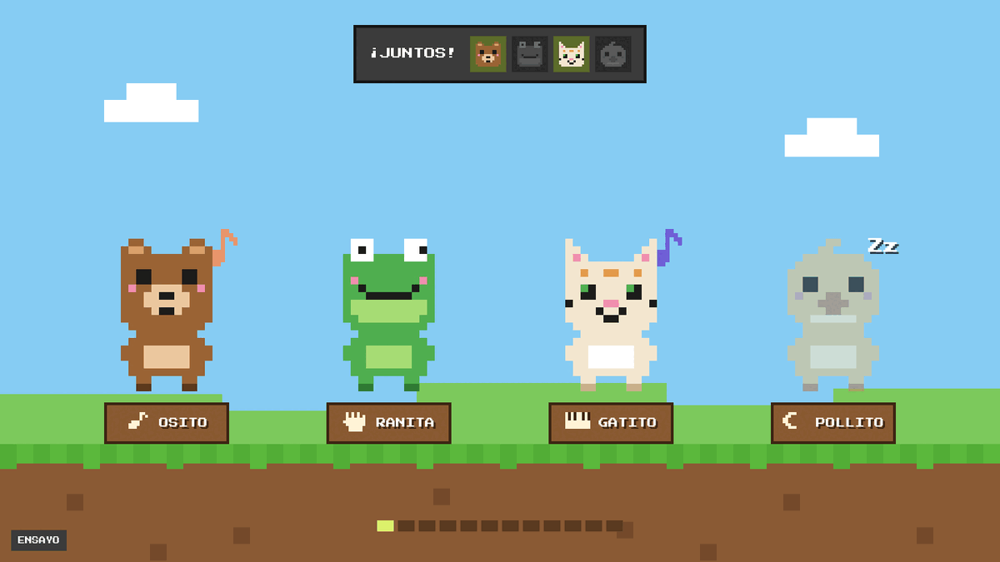
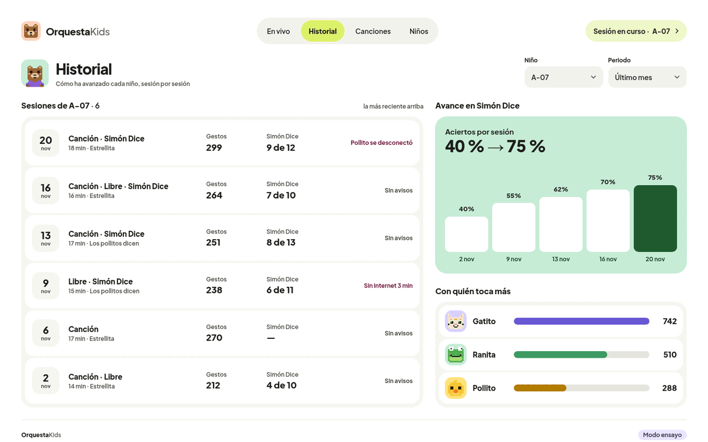
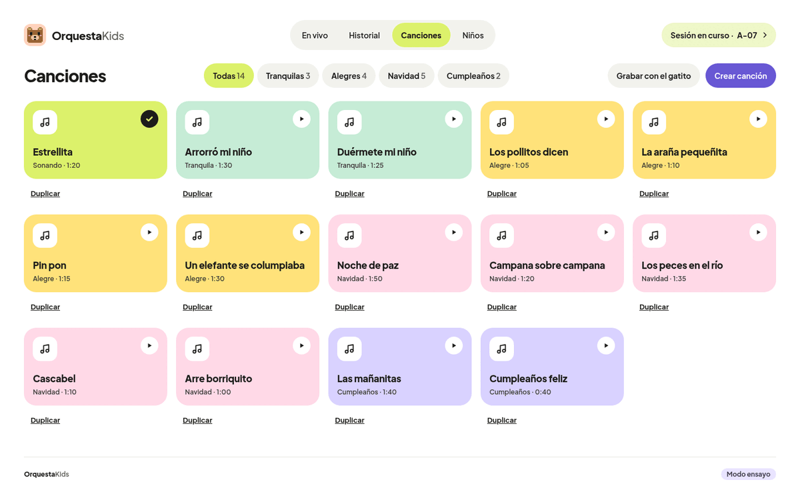
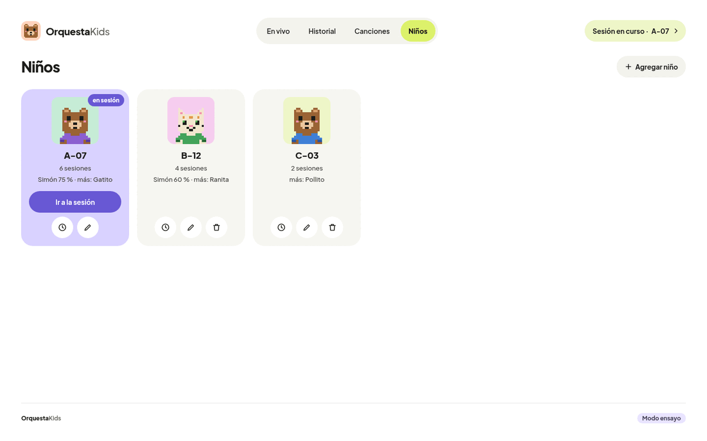
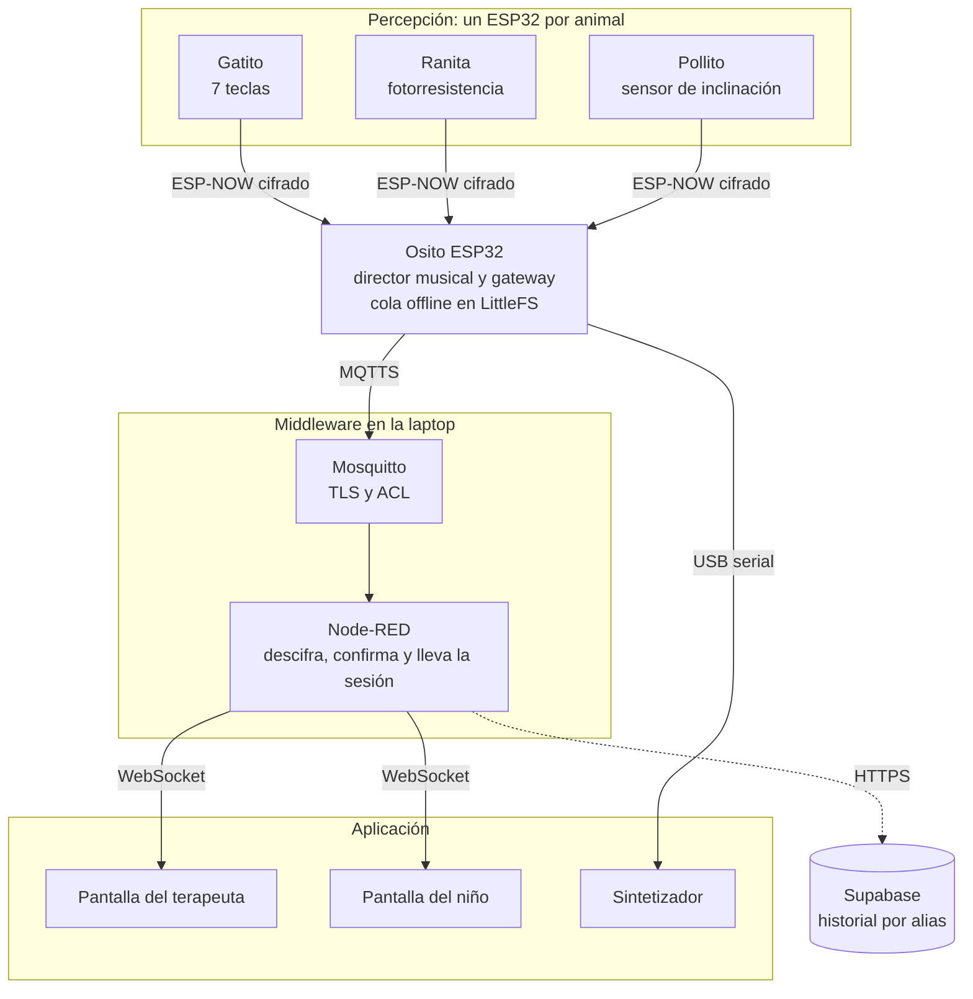
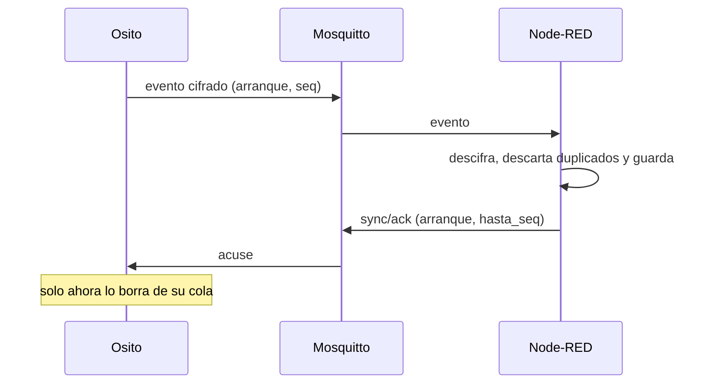

<div align="center">

# Orquesta de animalitos

Cuatro peluches con **ESP32** que tocan juntos una canción, pensados para **musicoterapia infantil**.
Cada animal toca una parte y esa parte solo suena mientras un niño lo está tocando: si tocan todos, suena completa.

[](firmware)
[](orquesta-proyecto.md)
[](nodered)
[](nodered/supabase.sql)



</div>

## Qué hace

- **Cuatro instrumentos**: el gatito toca la melodía, la ranita el acompañamiento, el pollito la percusión y el osito la base.
- **Tres modos de juego**: Canción, Libre (escala pentatónica, nada suena mal) y Simón Dice con secuencias que crecen.
- **Sonido sin retraso**: toda la música se decide en el ESP32 del osito, así responde al instante y sigue tocando aunque se caiga la red.
- **Pantalla del terapeuta**: la partitura de cada animal en vivo, el modo de juego, el estado de la conexión y el historial de cada niño.
- **Pantalla del niño** para el proyector, en estilo de bloques: se iluminan los animales que están tocando.
- **Alerta por tres canales** si un animal se desconecta: LED rojo en el osito, un tono y un aviso en pantalla.
- **No pierde datos sin red**: el osito guarda hasta 4000 eventos y los manda cuando vuelve la conexión.
- **Cifrado de punta a punta** y ninguna credencial en el código.

## Capturas

<table>
  <tr>
    <td width="50%"></td>
    <td width="50%"></td>
  </tr>
  <tr>
    <td align="center"><sub><b>Pantalla del niño.</b> Se iluminan los animales que tocan; "¡Juntos!" se llena cuando tocan todos.</sub></td>
    <td align="center"><sub><b>Historial.</b> Avance de cada niño en Simón Dice y con qué animal toca más.</sub></td>
  </tr>
  <tr>
    <td width="50%"></td>
    <td width="50%"></td>
  </tr>
  <tr>
    <td align="center"><sub><b>Canciones.</b> Incluidas y propias; se pueden escribir o grabar con el gatito.</sub></td>
    <td align="center"><sub><b>Niños.</b> Cada uno con su alias y avatar; su nombre nunca sale de la laptop.</sub></td>
  </tr>
</table>

## Los animales

| Animal | Parte | Sensor | Actuador |
|---|---|---|---|
| Gatito | Melodía (piano) | 7 botones, de *do* a *si* | 7 LEDs, uno por tecla |
| Ranita | Acompañamiento (violín) | Fotorresistencia: la sombra de la mano | 2 LEDs en las mejillas |
| Pollito | Percusión | Sensor de inclinación SW-520D: lo agitan | 1 LED |
| Osito | Base (bajo) y director | Potenciómetro, botón de modo y teclado 4x4 | LEDs de modo, LED de alerta y bocina |

## Cómo funciona



| Capa | Qué hace | Dónde |
|---|---|---|
| Percepción | Cada animal lee su sensor y convierte el gesto en un evento de pocos bytes | `firmware/` |
| Red | ESP-NOW entre animales y osito, sin router; Wi-Fi y MQTTS solo en el osito | `firmware/libraries/OrquestaComun/` |
| Middleware | Mosquitto recibe los eventos; Node-RED los descifra, los guarda y los reparte | `broker/`, `nodered/` |
| Aplicación | Pantallas del terapeuta y del niño, y el sintetizador que da el sonido | `web/`, `herramientas/` |

Un evento solo se borra del osito cuando Node-RED confirma que ya lo guardó:



Sin red, el osito guarda hasta 4000 eventos (64 en RAM y el resto en LittleFS) y sobreviven a un reinicio.
Si la laptop se queda sin internet, Node-RED guarda lo pendiente y lo sube a Supabase cuando vuelve.

## Seguridad

- **AES-128-GCM** en ESP-NOW y en cada evento MQTT, además de **TLS** con CA propia: ni el broker ve los gestos en claro.
- **Contra mensajes repetidos**: cada mensaje lleva `(arranque, seq)` y se rechaza si no es nuevo.
- **ACL** de mínimo privilegio en Mosquitto; no acepta clientes anónimos ni sin TLS.
- **Ninguna credencial en el código**: las claves viven en `.secrets/` (fuera de git) y se cargan por cable a la NVS de cada placa.

## Requisitos

- Arduino IDE 2 con el core **esp32 3.3.x**; el *Sketchbook location* es `firmware/`.
- **Mosquitto 2**, **Node.js** y **Node-RED** en la laptop.
- **Python 3** para el sintetizador y el aprovisionamiento.
- (Opcional) Un proyecto de **Supabase** para el historial en la nube.

## Cómo correrlo

```sh
git clone https://github.com/Kasinfire/Proyecto-IoT.git
cd Proyecto-IoT
./herramientas/preparar_mqtt.sh      # una vez: certificados y contraseñas locales en .secrets/
./herramientas/iniciar_todo.sh       # broker, Node-RED y sintetizador; Ctrl+C lo apaga todo
```

La interfaz queda en <http://127.0.0.1:1880/>. Sin placas, cualquier pantalla funciona en **modo ensayo**
agregando `?ensayo`, por ejemplo `en-vivo.html?ensayo`.

Aprovisionar las placas, cambiar de red, conectar Supabase y diagnosticar fallas está en [`COMANDOS.md`](COMANDOS.md).

## Pruebas

```sh
./firmware/osito/pruebas/correr.sh          # lógica del osito: modos, Simón Dice, cola offline
node --test nodered/pruebas/*.test.js       # Node-RED: descifrado, sincronización, Supabase
```

La matriz de pruebas de estrés con las placas está en [`docs/pruebas/matriz-estres.md`](docs/pruebas/matriz-estres.md).

## Estructura

```
Proyecto-IoT/
├─ firmware/
│  ├─ gatito/
│  ├─ ranita/
│  ├─ pollito/
│  ├─ osito/
│  │  └─ pruebas/
│  ├─ aprovisionar/
│  └─ libraries/OrquestaComun/
├─ broker/
├─ certs/
├─ nodered/
│  └─ pruebas/
├─ web/
│  ├─ css/
│  └─ js/
├─ herramientas/
└─ docs/
   ├─ capturas/
   ├─ diseno/
   ├─ pruebas/
   └─ reporte/
```

La especificación completa está en [`orquesta-proyecto.md`](orquesta-proyecto.md) y el estándar de código en
[`docs/estandar-codigo.md`](docs/estandar-codigo.md). Cada integrante trabaja en su rama y la integra a `main` con un pull request.

