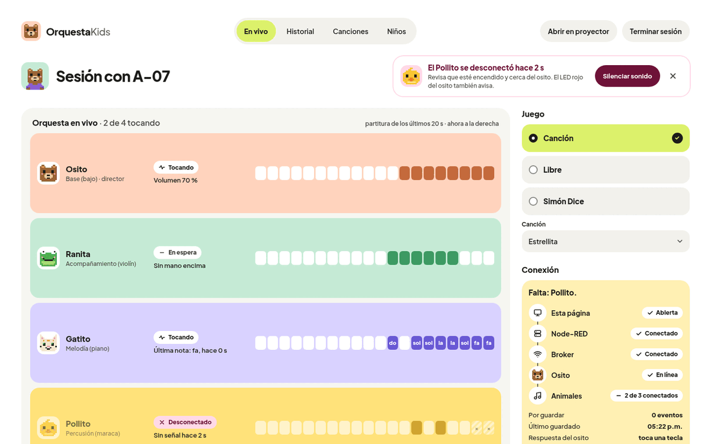
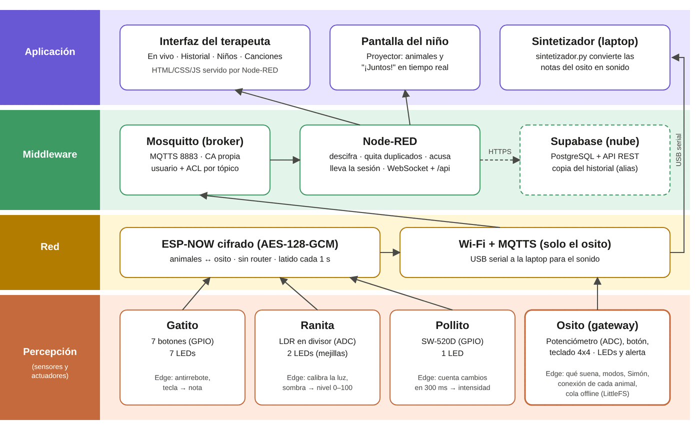
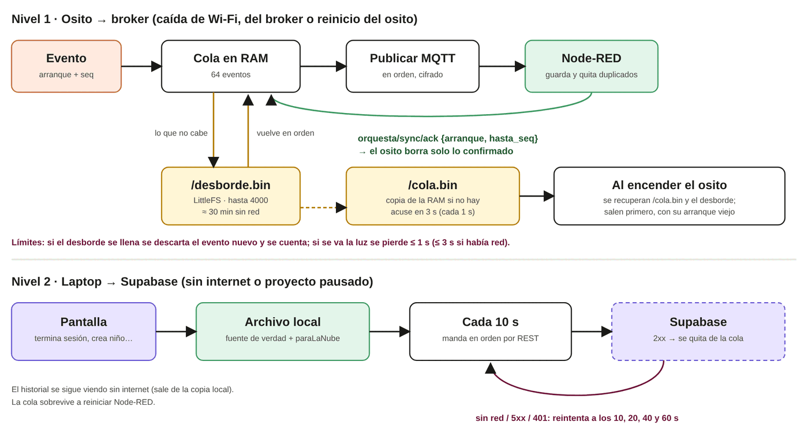

<div align="center">


# 🧸🐸🐱🐥 Orquesta de animalitos

**Cuatro peluches con ESP32 que tocan juntos una canción, para musicoterapia infantil.**

Cada animal toca una parte, y esa parte solo suena mientras un niño lo está tocando.
Si todos tocan a la vez, la canción suena completa.

*Proyecto final de Internet de las Cosas · Universidad de Guadalajara, CUCEI · Sección D03 · 2026B*

</div>

---

## 🎶 La orquesta

| | Animal | Toca | Cómo se toca | Responde con |
|---|---|---|---|---|
| 🐱 | **Gatito** | Melodía (piano) | 7 teclas, de *do* a *si* | Una luz por tecla |
| 🐸 | **Ranita** | Acompañamiento (violín) | Pasando la mano por encima (sombra sobre una fotorresistencia) | Las mejillas se encienden |
| 🐥 | **Pollito** | Percusión (maraca) | Agitándolo | Un destello |
| 🧸 | **Osito** | Base (bajo); dirige a los demás | Botón de modo, volumen y teclado DJ | Luces en la pancita y la bocina |

**Tres modos de juego:**

- 🎵 **Canción**: la base del osito suena siempre y cada parte entra cuando su animal se toca.
- 🎹 **Libre**: cada gesto toca una nota de la escala pentatónica; no hay notas que suenen mal.
- 💡 **Simón Dice**: el osito enciende un animal y el niño tiene que tocar ese. Las secuencias crecen poco a poco.

## 🖥️ Lo que ve el terapeuta



La partitura de cada animal en vivo, el modo de juego y el estado de cada conexión. Si un animal se
desconecta, el sistema avisa por **tres canales a la vez**: el LED rojo del osito, un tono por la bocina
y una alerta en la pantalla. Además hay un historial del avance de cada niño entre sesiones, un editor
de canciones y una pantalla de bloques para el proyector, que es la de arriba.

## 🧩 Cómo funciona



- **Edge:** toda la música se decide en el ESP32 del osito, así el sonido responde al instante y la
  orquesta sigue tocando aunque se caiga el internet.
- **ESP-NOW cifrado** entre los animales y el osito, sin router de por medio.
- **MQTTS** del osito a Mosquitto, y **Node-RED** reparte los eventos a las pantallas.
- **Supabase** guarda una copia del historial, solo con el alias del niño y nunca su nombre.

## 🔒 Seguridad

- **Dos capas de cifrado:** AES-128-GCM en ESP-NOW y en cada evento MQTT, además de TLS con CA propia.
  Ni el broker ve los gestos en claro.
- **Contra mensajes repetidos:** cada mensaje lleva `(arranque, seq)` y se rechaza si no es nuevo.
- **Permisos mínimos en el broker:** ACL por usuario; no acepta clientes anónimos ni sin TLS.
- **Ninguna credencial en el código.** Las claves viven en `.secrets/` (fuera de git) y se cargan por
  cable a la NVS de cada placa.

## 🛟 Si se cae algo



Un evento solo se borra del osito cuando Node-RED confirma que lo guardó:

- Sin red, el osito guarda hasta **4000 eventos** (64 en RAM y el resto en LittleFS), y sobreviven aunque se reinicie.
- Si la laptop se queda sin internet, Node-RED guarda lo pendiente y lo sube a Supabase cuando vuelve.

## 🚀 Ponerlo a andar

```sh
./herramientas/preparar_mqtt.sh      # una vez: certificados y contraseñas locales en .secrets/
./herramientas/iniciar_todo.sh       # broker, Node-RED y sintetizador; Ctrl+C lo apaga todo
```

Y abrir <http://127.0.0.1:1880/>. Sin placas, cualquier pantalla funciona en **modo ensayo** con
`?ensayo` (por ejemplo `en-vivo.html?ensayo`).

La guía completa (aprovisionar las placas, cambiar de red, Supabase, diagnóstico) está en
[`COMANDOS.md`](COMANDOS.md).

## 🧪 Pruebas

```sh
./firmware/osito/pruebas/correr.sh          # lógica del osito: modos, Simón, cola offline
node --test nodered/pruebas/*.test.js       # Node-RED: descifrado, sincronización, Supabase
```

La matriz de pruebas de estrés con las placas está en
[`docs/pruebas/matriz-estres.md`](docs/pruebas/matriz-estres.md).

## 📁 Qué hay en cada carpeta

| Carpeta | Contenido |
|---|---|
| `firmware/ranita/` · `gatito/` · `pollito/` · `osito/` | Un sketch por animal |
| `firmware/libraries/OrquestaComun/` | Lo que comparten: protocolo ESP-NOW, cifrado, antirrebote, colas |
| `firmware/aprovisionar/` | Carga claves, MAC y canal en la NVS por cable |
| `broker/` · `certs/` | Mosquitto con TLS y ACL; solo certificados públicos |
| `nodered/` | Flujos, lógica de la sesión, copia en Supabase (`supabase.sql`) |
| `web/` | Pantallas del terapeuta y del niño, sin dependencias |
| `herramientas/` | Preparar, aprovisionar, arrancar todo, sintetizador |
| `docs/` | Reporte, pruebas, diseño y estándar de código |

La especificación completa está en [`orquesta-proyecto.md`](orquesta-proyecto.md).

## 🤝 Para el equipo

- Cada quien trabaja en su rama y la integra a `main` con un pull request.
- El firmware sigue el [estándar de código](docs/estandar-codigo.md). En Arduino IDE, el
  *Sketchbook location* es `firmware/`.
- Si Mosquitto de Homebrew corre como servicio, detenlo antes (`brew services stop mosquitto`):
  ocupa el puerto 8883 con otro certificado.
- Aprovisionar sin copiar secretos a mano: carga `firmware/aprovisionar` y corre
  `python3 herramientas/aprovisionar.py <puerto> osito`, o `<animal> --mac-osito … --canal …`.

---

<div align="center">

**Equipo**

Kelly Anahí Arellano Villaseñor · Darío Martinez Escareno · Celso Emanuel Vargas Mora ·
Laura Yaneri Albarran Bernal · Fatima Gabriela Espinoza Robles

Internet de las Cosas · Mtro. Angel Ignacio Paredes Lopez

🧸🐸🐱🐥

</div>
